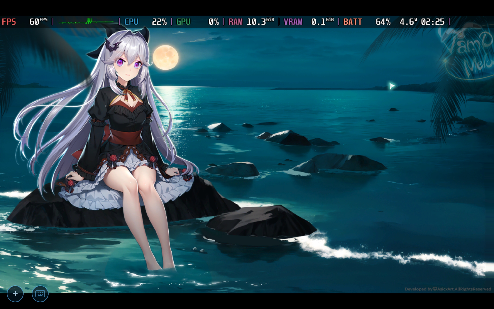
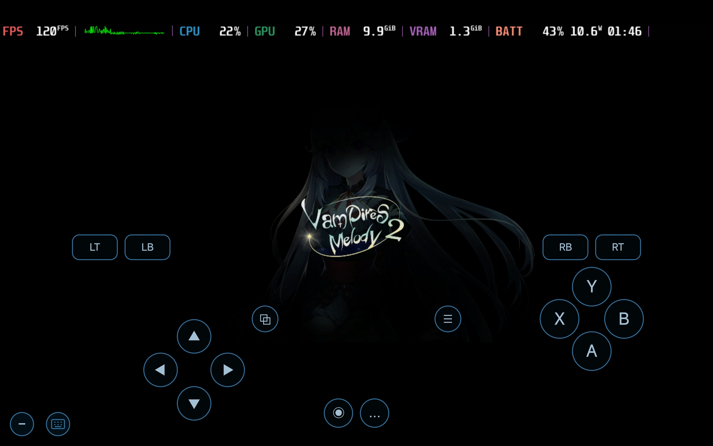

# DroidDeck GPU 修复

[English](README.md)

一个 KernelSU 模块：修复澎湃（HyperOS）移植 ROM 上 DroidDeck
容器 GPU 不工作、掉回 CPU 软渲染的问题。

## 现象

联想拯救者 Y700 四代（骁龙 8 Elite / Adreno 830）的澎湃 OS 4
移植版上，DroidDeck 容器里悬浮窗 GPU 恒为 0%、CPU 约 53%，
游戏约 40 帧乱跳——纯 llvmpipe 软渲染。同一套容器配置在
ColorOS 移植版上 GPU 正常工作。GPU 设备节点 /dev/kgsl-3d0
存在、权限 0666、SELinux 标签（gpu_device）正确。把 SELinux
切到 permissive，GPU 立即复活（120 帧、GPU 31%）——问题在
策略，不在驱动，也不在设备节点。


## 修复前 / 修复后

修复前（llvmpipe 软渲染——悬浮窗自己的 GPU 遥测读取也被拒了一半，
会话本身更是没 GPU 在跑）：



修复后（本模块生效、SELinux 保持 Enforcing——GPU 被正确识别并工作）：



## 根因

permissive 模式下抓到的 AVC 拒绝日志显示：针对 GPU 设备节点
本身的拒绝是**零**。真正被拒的是容器应用域（untrusted_app_27）
在会话启动时的"GPU 身份探测"，且在 enforcing 下被 dontaudit
静默吞掉：

- 读 vendor_sysfs_kgsl 文件（型号、温度、gpu_busy_percentage）
- 读属性上下文 vendor_soc_model_prop、vendor_default_prop
- search sysfs 目录（hwmon）

DroidDeck 的启动辅助进程靠读这些 sysfs 和属性来确认 GPU
身份；读了个空，它就判定"没有 GPU"，按软渲染开会话——根本
没去打开设备节点。（悬浮窗那个"GPU 0%"里还有一半是它自己的
遥测读取也被拒造成的假读数。）

成因是移植包的 SELinux 策略合并缺口：捐献机 vendor 把这些
文件打成 vendor 专属类型，策略却没给应用域补放行。两个移植
包是同一位作者，ColorOS 那件的缺口没缺在 GPU 这条路上。

## 解法

sepolicy.rule 补四条窄放行，代替把整台设备挂 permissive：

```
allow untrusted_app_27 vendor_sysfs_kgsl file { read open getattr }
allow untrusted_app_27 vendor_soc_model_prop file { read open getattr map }
allow untrusted_app_27 vendor_default_prop file { read open getattr map }
allow untrusted_app_27 sysfs dir { search }
```

## 安装

在 SukiSU / KernelSU 里刷入模块后**完全重启**——软重启不够，
策略规则只在开机时加载。验证：getenforce 为 Enforcing，且
DroidDeck 悬浮窗 GPU 不再钉在 0。

## 备注

- 若 DroidDeck 更新改变了它的 SELinux 域（当前为
  untrusted_app_27），需同步修改 sepolicy.rule 里的域名。
- v1.0 有意未放行：execstack、proc/debugfs 类遥测——在已验证
  的设备上 GPU 识别用不到它们。

## 作者与协议

制作者：Muse · MIT License
